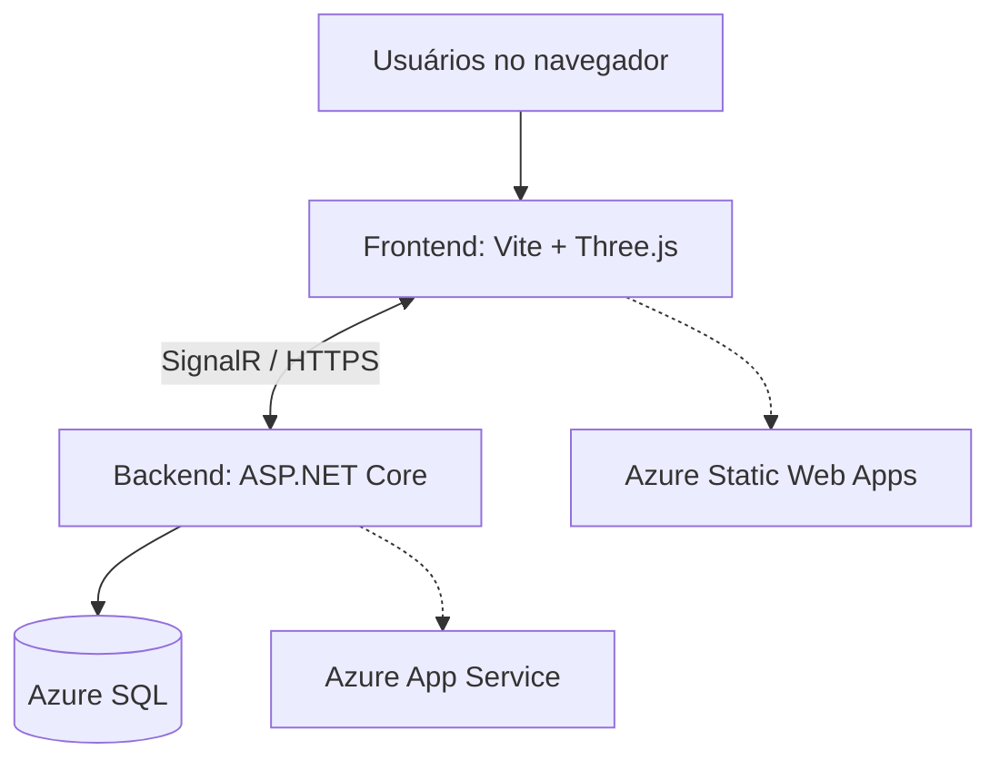

<div align="center">

# 🧊 Laboratório WebGL 3D

### Explore, personalize e compartilhe cenas tridimensionais diretamente no navegador.

Uma aplicação web interativa para experimentar conceitos de **Computação Gráfica**, com manipulação de objetos 3D e **colaboração multiusuário em tempo real**.

[](https://threejs.org/)
[](https://developer.mozilla.org/pt-BR/docs/Web/JavaScript)
[](https://vite.dev/)
[](https://dotnet.microsoft.com/)
[](https://azure.microsoft.com/)

**[🚀 Acessar o laboratório](https://purple-water-0ebaab710.3.azurestaticapps.net/)** · **[📁 Código-fonte](https://github.com/GustavoTessaro/laboratorio-webgl-3d)**

</div>

---

## 📖 Sobre o projeto

O **Laboratório WebGL 3D** é um ambiente didático de experimentação gráfica no navegador. Nele, é possível criar e personalizar objetos tridimensionais, explorar transformações geométricas e observar os resultados diretamente na cena.

O projeto também conta com uma sala compartilhada: diferentes participantes podem acessar o laboratório e acompanhar alterações na cena por meio de uma conexão em tempo real.

## ✨ Funcionalidades

| Recurso | Descrição |
| --- | --- |
| 🧱 **Objetos 3D** | Adição de cubos, esferas, pirâmides e toroides à cena. |
| 🖱️ **Interação com a cena** | Seleção de objetos, navegação pela câmera, órbita e zoom. |
| 📐 **Transformações** | Movimentação, rotação e redimensionamento dos objetos. |
| 🎨 **Personalização** | Alteração de cores, aparência e materiais dos objetos. |
| 💡 **Iluminação** | Ajustes visuais de iluminação para explorar a percepção tridimensional. |
| 📋 **Gerenciamento** | Duplicação e exclusão de objetos, além de cópia e aplicação de propriedades. |
| 👥 **Colaboração em tempo real** | Participantes na mesma sala acompanham alterações compartilhadas. |
| 🔄 **Reconexão** | Tratamento de estados de conexão e recuperação da participação na sala. |
| 💻 **Modo local** | Possibilidade de utilizar o laboratório sem entrar na colaboração. |

## 🖼️ Visão geral

A interface é dividida em duas áreas principais:

- **Cena 3D:** espaço de visualização e interação com os objetos.
- **Painel de controles:** ferramentas para adicionar, selecionar e personalizar elementos da cena.

> **Dica:** adicione aqui uma captura de tela do laboratório em funcionamento para destacar o projeto logo na página do repositório.

## 🛠️ Tecnologias

| Camada | Tecnologias | Responsabilidade |
| --- | --- | --- |
| **Frontend** | JavaScript, HTML, CSS, Vite | Interface, interação e construção da aplicação web. |
| **Gráficos 3D** | Three.js e WebGL | Renderização e manipulação da cena tridimensional. |
| **Backend** | ASP.NET Core (.NET 10) | Serviços da aplicação e suporte à colaboração. |
| **Tempo real** | ASP.NET Core SignalR | Comunicação entre os participantes conectados. |
| **Persistência** | Entity Framework Core e Azure SQL | Acesso e persistência de dados no backend. |
| **Hospedagem** | Azure Static Web Apps e Azure App Service | Publicação do frontend e da API. |
| **Automação** | GitHub Actions | Build e implantação da aplicação. |

## 🏗️ Arquitetura



A renderização da cena acontece no navegador. A comunicação entre os participantes utiliza o **SignalR**, enquanto o backend é responsável pelos serviços e pela integração com a camada de persistência.

## 🚀 Executando localmente

### Pré-requisitos

- [Node.js](https://nodejs.org/) e npm instalados.
- Git instalado.
- Para testar a colaboração com o backend localmente, um ambiente .NET compatível e a configuração correspondente da API.

### 1. Clone o repositório

```bash
git clone https://github.com/GustavoTessaro/laboratorio-webgl-3d.git
cd laboratorio-webgl-3d
```

### 2. Instale as dependências

```bash
npm ci
```

### 3. Inicie o frontend

```bash
npm run dev
```

Abra no navegador o endereço informado pelo Vite no terminal.

### 4. Configure a colaboração (opcional)

Para conectar o frontend a uma instância do backend, configure a variável de ambiente `VITE_COLLABORATION_URL` com a URL HTTPS completa do hub SignalR:

```env
VITE_COLLABORATION_URL=https://SEU-BACKEND/hubs/laboratory
```

Essa variável pode ser definida em um arquivo `.env.local` na raiz do projeto. **Não inclua credenciais ou segredos nesse arquivo versionado.**

> O backend precisa estar acessível e permitir a origem do frontend nas configurações de CORS. Caso contrário, utilize o modo local.

### Build de produção

```bash
npm run build
```

O Vite gera os arquivos de distribuição na pasta `dist/`.

## ☁️ Publicação no Azure

O projeto utiliza dois serviços de hospedagem:

- **Azure Static Web Apps:** entrega dos arquivos estáticos do frontend.
- **Azure App Service:** execução do backend ASP.NET Core e do hub SignalR.

O banco de dados utiliza **Azure SQL**, e o **GitHub Actions** automatiza o processo de publicação.

**Aplicação publicada:** https://purple-water-0ebaab710.3.azurestaticapps.net/

## 🧪 Testes e validação

Durante o desenvolvimento, foram realizados testes de build e verificações funcionais da aplicação, incluindo cenários com dois navegadores conectados simultaneamente à mesma sala.

Entre os comportamentos verificados estão a criação e a edição de objetos, a sincronização das alterações entre participantes e a recuperação da cena ao atualizar a página.

Para validar o build do frontend:

```bash
npm run build
```

## 📚 Contexto acadêmico

Este projeto foi desenvolvido no contexto de estudos de **Computação Gráfica**, reunindo conceitos como geometria tridimensional, transformações, materiais, iluminação, renderização em tempo real e interação com objetos em um ambiente web.

## 👨‍💻 Autor

**Gustavo Tessaro**

[](https://github.com/GustavoTessaro)

---

<div align="center">

**Laboratório WebGL 3D** · Computação Gráfica, interatividade e colaboração em tempo real.

</div>

<div align="center">

## ⭐ Se este projeto foi útil para você, considere deixar uma estrela no repositório!

</div>
